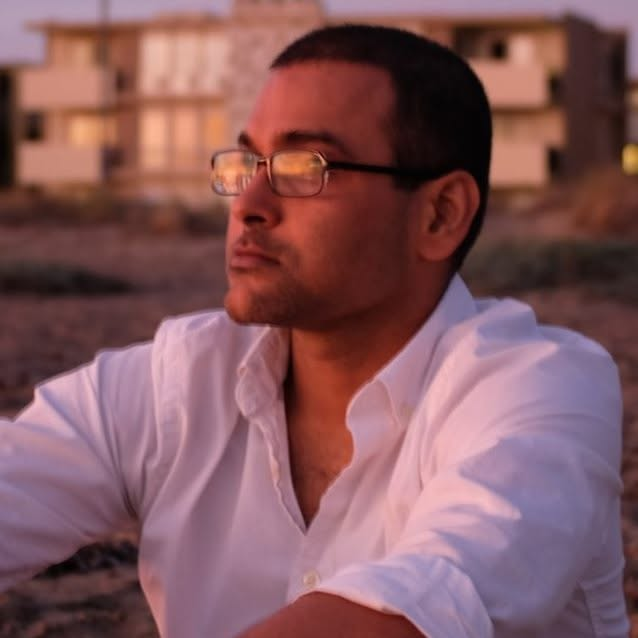

# Vishal Patel

I'm a full-stack software engineer and technical project manager living in Carlsbad, in North County San Diego.

I've spent my career taking software from idea to production. Over the years, I've co-founded several businesses, often two-sided marketplaces, in areas like market research and classic cars, among others. I freelanced for companies like GoPro, Stubhub's ZVents and Dot429, and was a tech lead at the Public Library of Science. As a technical project and product manager at Riviera Partners, I helped redesign and rebuild the whole system. In between, I co-founded NorCal Microgreens and ran a farm-to-table microgreens business.

These days I build my own things. I'm currently working on [Social Activities](https://github.com/vishaldpatel/socialactivities), an app for creating and sharing event lists for people who live in San Diego. I recently made [omarchy-pass](https://github.com/vishaldpatel/omarchy-pass), an Omarchy plugin for the Pass password manager. I also have a couple of hardware projects underway, which I hope to talk about soon.

When I'm not at a keyboard, I'm in the water. I run [Surfers of North County](https://www.youtube.com/@soncsd), a YouTube channel featuring surfing in North County San Diego.

## Writing

- 2026-09-28 — [What it feels like to truly vibe code a project from start to finish (in late 2026)](posts/what-it-feels-like-to-truly-vibe-code-a-project-from-start-to-finish-in-late-2026.md)
- 2026-08-06 — [The Banana iced mocha - my go to #WFH summer drink for working from patio.](posts/the-perfect-summer-coffee-drink.md)
- 2026-07-16 — [A few tips from the (startup) trenches for managing stress](posts/habits-that-will-keep-the-stress-under-control.md)
- 2026-03-24 — [How to play Flight Simulator in VR on an EC2 Cloud gaming instance](posts/how-to-play-flight-simulator-in-vr-on-an-ec2-cloud-gaming-instance.md)
- 2026-03-19 — [Some ideas for companies that need people to come to the office](posts/some-ideas-for-companies-that-need-people-to-come-to-the-office.md)
- 2025-03-26 — [No one understands Points, and most don't care! (oknext.io)](posts/oknextio-no-one-understands-points-and-most-dont-care.md)
- 2025-01-25 — [How to Delay slow operations until the second render in Phoenix LiveView](posts/phoenix-liveview-delay-slow-operations-until-the-second-load.md)
- 2024-12-02 — [Two strategies for preventing duplicate event handlers in JavaScript](posts/two-strategies-for-preventing-duplicate-event-handlers-in-javascript.md)
- 2024-10-28 — [From Dev to Production for a small Phoenix project](posts/how-i-deployed-a-small-phoenix-website-to-production.md)

See the [full index](index.md).

## Résumé

- [Software Engineer](assets/Vishal%20Patel%20-%20Software%20Engineer.md)
- [Product / Project Manager](assets/Vishal%20Patel%20-%20PM.md)

## Elsewhere

[GitHub](https://github.com/vishaldpatel) · [LinkedIn](https://linkedin.com/in/vishalontheline) · [YouTube](https://www.youtube.com/@soncsd) · [vishal@vishal.rs](mailto:vishal@vishal.rs)
